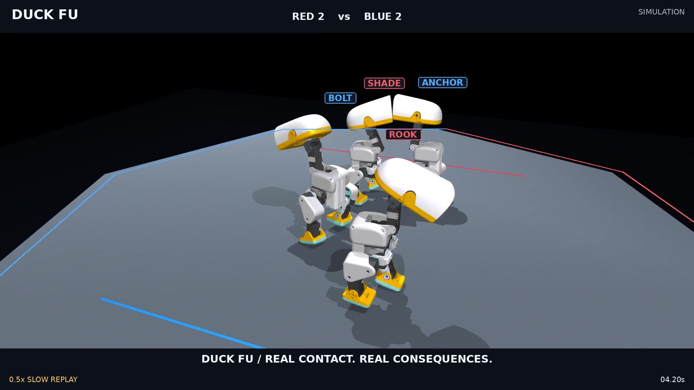
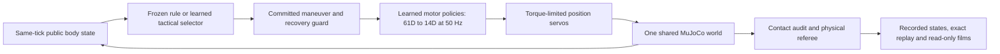

# Duck Fu — physical robot duels and team combat

**English** · [简体中文](README.zh-CN.md)

Duck Fu is a simulation game for native, armless **Pollen Robotics Microducks**. Two robots duel, or four fight in red/blue teams on a fixed octagonal platform. They approach, commit to a physical bump, sidestep, turn back, counter and recover. Joint actuation, contact forces, gravity and loss of support determine what actually happens.



[English main film](media/duck_fu_team_hero.mp4) · [Vertical short](media/duck_fu_team_short.mp4) · [Continuous silent match](media/duck_fu_team_reference.mp4) · [Technical close-ups](media/duck_fu_team_technical.mp4) · [Continuous 1v1](media/duck_fu_duel_reference.mp4)

Main film: 1080p/50 fps, with clearly marked slow replays. The technical film shows actual collision hulls, measured contact response and recovery. English narration, synthesized music/foley and camera motion are post-production; they do not influence the simulation. English and Chinese SRT files accompany the narrated films. There are no generated intermediate motion frames.

## Architecture



**Motor control.** Each robot has an independent 61D observation and previous-action history. ONNX policies produce 14 joint position offsets, without an output low-pass filter. Contact drive, lateral evasion and combat walking were trained for the deployed, capped PD model; standing and sit-to-stand recovery use upstream learned priors. A skill ends through its own trained zero-command braking stage, measured foot support and settling. Switching policies does not reset action history.

**Tactics.** A 34D public observation feeds a `34 → 64 tanh → 64 tanh → 9-action` categorical actor. The actions are approach, two orbits, dash, two sidesteps, brace, center and retreat. Training starts with explicitly labelled rule-trajectory distillation, then uses online categorical PPO against frozen historical, latest and rule opponents. Actual maneuver durations enter semi-Markov GAE; a fallen teammate's terminal reward is not delivered early. The team actor shares weights between teammates. Target assignment is explicit minimum-distance team coordination, with target switching after elimination.

A maneuver holds its attack direction, has a physical low-head wind-up and braking, and can miss. Defenders observe actual head pose and recent relative motion; they cannot read the opponent's hidden attack phase, selected action, future trajectory or random seed. The tactical action mask uses the same octagonal face geometry as the platform.

**Physics.** Every robot has the same original **0.73724318 kg** mass/inertia and **±0.6405 Nm** torque limit. The final profile uses MuJoCo 3.12, Newton/80 iterations and 0.125 ms integration steps; motor inference remains 50 Hz. Inter-robot contact uses 70 massless, unsimplified visual-component convex hulls per robot, with distinct masks to prevent duplicate responses. Native self/ground contacts remain. Teammates collide too. Component convexification approximates concavity; this is not exact triangle-surface contact or a validated hardware digital twin.

**Referee.** Ring-out requires an actual fall below the platform and lost support; a public ten-second down count handles prolonged inability to stand. Stable recovery requires a supported dwell, not one upright frame. No hit points, scripted winner, root teleport, added root force, temporary immunity or deletion of eliminated bodies is used. Timeouts and simultaneous elimination can draw. Numerical faults produce **NO_CONTEST_PHYSICS**, never a win.

## Evidence and limitations

[Final results and qualification](RESULTS.md) separates motor tests, recovery, game cross-play, numerical checks and human viewing acceptance. [Machine-readable final summary](../../artifacts/combat/complete-summary.json) links the frozen protocols and compressed raw reports. The final game evaluation uses **32 base seeds × both sides per opponent**, with arena rotations; the 64 games are paired observations, not 64 independent seeds.

The film is selected from a completed, physically valid match for readable interaction; it is not an unbiased success-rate estimate. The continuous reference and closed-loop replay expose the complete selected match. Contact response events require positive measured contact and observed displacement/imbalance; they are descriptive measurements, not a causal damage model or the win condition.

Not every fall recovers quickly, especially under continuing interference or near the edge. The old rolling recovery motor was rejected after self-contact failures and is disabled in the final competition. Short kicks and roll escapes are not claimed. Numerical no-contests, missed attacks, draws and unsuccessful recoveries remain in the reports. Historical failed reward and solver versions are retained in [experiments](03_experiments.md) and the [early lab](EARLY_LAB.md).

This game uses local learned policies and local controllers. **Jev and a network LLM are not in its reflex or tactical loop.** The ROSClaw combat MCP adapter has typed SIM tools and read-only status checks; official daemon-authorized combat receipt validation is still pending, and executor reports are not presented as authorization receipts. No hardware deployment or autonomous evolution is claimed. Human viewing acceptance remains pending until people review the film.

The selected film is seed **50006**, using `configs/combat/team_film.yaml`: RED uses the frozen team PPO actor and BLUE uses the frozen pressure rule controller; all four use learned joint motors. Recreate that exact configuration with `--brain learned --seed 50006 --capture`. The ordinary `team_final.yaml` example uses a counter rule opponent instead. The [film selection record](../../artifacts/combat/team-film-selection.json) explains the presentation bias.

## Run and replay

Use the `feat/duck-fu` checkout, Python 3.13 and the pinned assets from the repository bootstrap. From the repository root:

```bash
python3 -m venv .venv
.venv/bin/python -m pip install -c requirements-combat.txt -e '.[dev,combat-audit]'
export MICRODUCK_ROOT="$PWD/.assets"
.venv/bin/python scripts/bootstrap.py

PYTHONPATH=src OPENBLAS_NUM_THREADS=1 .venv/bin/python scripts/run_combat.py \
  --config configs/combat/team_final.yaml --brain learned --seed 50001 \
  --capture --out artifacts/combat/local/my-team-match
PYTHONPATH=src OPENBLAS_NUM_THREADS=1 .venv/bin/python scripts/replay_combat.py \
  --run artifacts/combat/local/my-team-match
PYTHONPATH=src .venv/bin/python scripts/combat_director.py \
  --run artifacts/combat/local/my-team-match --edition reference --out out/my-reference.plan.json
PYTHONPATH=src .venv/bin/python scripts/render_combat_film.py \
  --plan out/my-reference.plan.json --out out/my-reference.mp4
```

For 1v1 use `configs/combat/duel_final_learned.yaml`. A new seed may draw, fail to produce a suitable edited film, or be rejected numerically. Outputs must be fresh directories. `--brain rule` requires a configuration without a learned tactical actor; unsupported modes fail explicitly.

```bash
PYTHONPATH=src OPENBLAS_NUM_THREADS=1 .venv/bin/python scripts/eval_combat.py \
  --protocol configs/combat/eval_motors_v5.yaml --out artifacts/combat/local/my-motor-eval
PYTHONPATH=src OPENBLAS_NUM_THREADS=1 .venv/bin/python scripts/eval_combat_matches.py \
  --protocol configs/combat/eval_duel_final.yaml --jobs 8 --out artifacts/combat/local/my-duel-crossplay
.venv/bin/python -m pytest tests -q
```

[Motor training source, exports and checkpoints](../../training/combat/README.md) · [Physics contract](02_physics_contract.md) · [Source audit](00_source_audit.md) · [Scope and rules](01_scope_and_rules.md)

Code is Apache-2.0. Pollen Robotics robot assets and pretrained policies retain their separate upstream terms; see [THIRD_PARTY](../../THIRD_PARTY.md). No Release or tag is published before user acceptance.

[Final source and asset lock](../../configs/combat/complete.source.lock.yaml) · [Delivery / 交付清单](DELIVERY.md)
