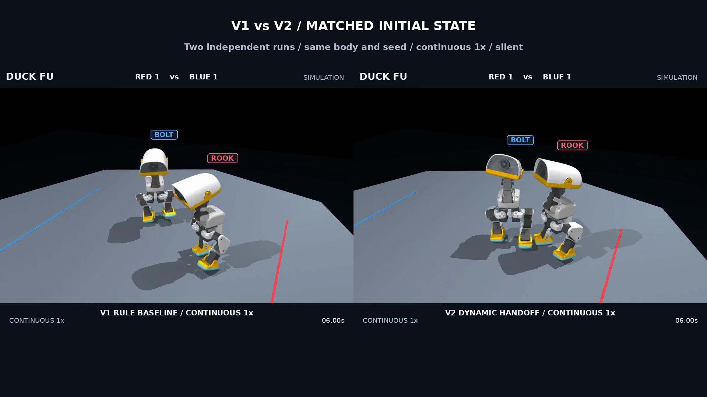

# Duck Fu V2: exchanges, transitions and team intent

**English** · [简体中文](README.zh-CN.md) · [V1 methods](../README.md) · [Results](RESULTS.md)

**Latest:** [Tactical 2v2 — draw, flank, counter and withdrawal cover](tactics/README.md), with an English commentary film. [Round two](round2/README.md) and the first-round methods below remain available for comparison.

This is the first V2 development round: exchange diagnosis, bounded short/committed attacks, state-conditioned handoffs, and a transparent team-intent prototype. It is not a completed V2 release or evidence of stable tactical superiority.

[](media/duck_fu_v2_duel_comparison.mp4)

| Silent, actual-state sample | Duration | Setting |
| --- | ---: | --- |
| [V1 vs V2](media/duck_fu_v2_duel_comparison.mp4) | 15 s | Same initial state and frozen reactive pressure opponent |
| [Full brake vs dynamic handoff](media/duck_fu_v2_transition_ablation.mp4) | 15 s | Same V2 interface; handoff ablation |
| [Probe vs committed drive](media/duck_fu_v2_attack_comparison.mp4) | 8 s | Standing-target action course, not a free bout |
| [Team intervention course](media/team_course.mp4) | 20 s | Declared pressure initialization; free physical execution |
| [Free 2v2 reference](media/team_free.mp4) | 20 s | Rule team scheduler against reactive rule opponents |
| [Contact detail](media/slow_detail.mp4) | 7.2 s | Explicit 0.25x replay of recorded integration states |

All films use English labels and 50 fps. Comparisons contain two independent, continuous runs. They do not splice a fictional match. [Selection record](../../../artifacts/combat/v2/film-selection.json).

## Method

The three frozen V1 motor networks remain unchanged: contact drive, lateral evasion and combat walking, with 61 observations, 14 joint targets and 50 Hz execution. **No new motor weights or enlarged PPO run were trained in this round.** V2 adds bounded rule composition over these learned motors.

A probe has a closer entry, shorter windup, lower travel ceiling and shorter commitment than a drive. Dynamic transitions require measured own support force, body motion, joint state and action history. Public head pose and motion estimate threats; enemy private phases never enter the actor. Unsafe entries retain braking/recovery. Low-amplitude requests that produced almost no motion were replaced by measured walking-command combinations; joint outputs are not blended or filtered.

A shared public-state scheduler assigns target, role and intent: PRESS_FLANK, PEEL_COVER and RESET_SWAP. Focus fire is legal, with target commitment and hysteresis. Execution may lag assignment until a safe boundary. Contact is qualified separately from the displayed assignment. V1 34D/9-action tactical weights are explicitly incompatible with the V2 contract. Current tactics are rules, without Jev or a network LLM.

## Evidence and limits

The frozen actor is `1e5f3a6`. Eighty scheduled validation runs passed the unchanged numerical proposal; maximum penetration was **1.313 mm**. They comprise 48 short duels, 16 action courses and 16 team runs/courses, with **16 distinct base seeds**, not 80 independent seeds.

Probe/drive median complete-maneuver durations were **1.10/2.06 s**, with paths **0.173/0.382 m**. Observed-response audits qualified **6/8 probes and 8/8 drives**. Shorter commitment comes with a different effect profile.

Against pressure, V1/full-brake/dynamic produced **0/2/4** observed clean evade counters across eight runs each; all were zero against counter-style opponents. In the same-enemy-attack paired example, response latency after evasion fell from **2.74 to 2.34 s**—**14.6%**, below the proposed 30% target. This small sample does not establish a general gain. Falls and failures remain in the reports.

The team course produced **one strictly qualified intervention across eight runs**; free 2v2 produced none. Qualification requires actual retargeting, at least 0.12 s and 3 cm own directed travel, retained role/target/plan and measured contact. Contact-only intermediate labels and near-instant incidental collisions are preserved separately. No causal saved-win or pressure-relief claim is made.

Legacy active-phase strike events remain intact. A separate offline audit measures delayed response within 0.30 s after contact, uses only completed-episode impulse evidence and truncates competing-contact windows. This secondary observational measure changes neither rewards nor outcomes. [Results and limitations](RESULTS.md) explain timestep sensitivity, recovery, human review and official ROSClaw receipt gaps.

Selected duel/team closed-loop replays regenerate **120,000/160,000 states with zero error**. There are **207 passing tests**. Human viewing acceptance remains pending; reproducibility is not hardware validation.

## Run

Install the [locked V1 environment and assets](../README.md), then run from the repository root with a new output directory:

```bash
export MICRODUCK_ROOT="$PWD/.assets"
PYTHONPATH=src OPENBLAS_NUM_THREADS=1 .venv/bin/python scripts/run_combat.py \
  --config configs/combat/v2/selected_dynamic.yaml --brain rule --seed 91003 \
  --capture --out artifacts/combat/local/my-v2-duel
PYTHONPATH=src OPENBLAS_NUM_THREADS=1 .venv/bin/python scripts/replay_combat.py \
  --run artifacts/combat/local/my-v2-duel
```

For the team course, use `selected_team_course.yaml`, seed 93004. Use `selected_team_free.yaml`, seed 92001 for the selected free bout. Full local integration arrays are not GitHub media assets. Recreate captures and plans after relocating; archived plans include original absolute source paths.

[Machine-readable evaluation](../../../artifacts/combat/v2/final-evaluation.json) · [Physical comparison](../../../artifacts/combat/v2/selected-physics-check.json) · [Film frame checks](../../../artifacts/combat/v2/film-checks.json)

Short kicks, trained transition weights, qualified rolling escape, feint-induced reactions, team-learning ablations, five-person comprehension tests and official ROSClaw authorization receipts are not completed. No Release, tag or merge is created for this round.

[首轮实施报告 / Implementation report](IMPLEMENTATION.zh-CN.md)
