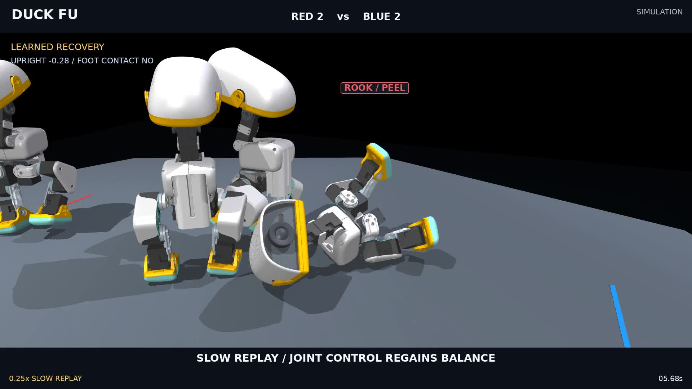

# Duck Fu: learned body stabilization and recovery

[中文](README.zh-CN.md) · [Training source, checkpoints and logs](../../../../training/combat/recovery-v2/README.md) · [Machine-readable evaluation](../../../../artifacts/combat/v2/body-recovery/final-evaluation.json) · [Earlier team-control work](../round2/README.md)

This experiment trains a new **body motor**, then tests how it hands control back to standing and walking. The tactical planner, referee, robot geometry, inertia and torque limits stay unchanged. The result improves recovery on saved physical states and shortens many recovery episodes in free matches. **It does not establish better edge safety or overall competitive strength.** The new recipe is optional; existing configurations retain the old recovery behavior.

[](media/recovery_en.mp4)

[English video](media/recovery_en.mp4): **88.88 seconds, 1080p, 50 fps, silent**. It contains the complete first predeclared held-out match, followed by 0.25× recovery and foot-support close-ups. Cameras follow recorded states; nameplates avoid overlap. The upper-left overlay reports the actual selected motor, uprightness and solved foot contact. Team-role nameplates describe assignments, rather than the current motor. The source match is a time-limit draw; it was not chosen by winner or best recovery time.

## Method

The actor remains a hot-swappable **61D observation → 14 joint-offset** network. It observes its own angular velocity, gravity direction, joint positions and velocities, previous executed action, and the standard 13 command slots. Recovery commands are zero; no hidden recovery flag is written into a velocity command. An official ONNX export bakes the observation normalizer into the model.

1. Capture complete physical games and sample states before, during and after real loss of balance. Preserve root tilt and height, all joint states, root and joint velocities, and the **preceding executed action**. XY/yaw normalization is initialization-only. Training uses 92 snapshots from 12 recovery events in four contributing trajectories; another collected trajectory had no recovery event.
2. Fine-tune the native standing actor using local GPU PPO, 256 environments, four-second episodes and 50 Hz control. Potential progress rewards rising, while standing rewards require measured foot load, height, uprightness and low speed. There are no runtime root pushes, pose keyframes or action filters.
3. Deploy checkpoint **150** through a measured recovery guard. It starts on actual uprightness below 0.80, uses the learned motor while still tilted below 0.94, and hands upright control to the existing standing motor. Learned control is bounded to two seconds per recovery. After three seconds, the previous get-up guard remains available as fallback. Completion requires 0.30 seconds of upright, loaded-foot, body-clear, low-speed support, followed by 0.30 seconds of settling before normal tactics resume.

This separation matters: continuously running checkpoint 150 passed all development get-ups but failed two subsequent walking checks. The measured handoff passed **92/92 get-up and walking checks** on those development states. The implementation preserves velocity and action history throughout the handoff.

The reward and runtime use different, explicit support measurements. GPU training averages actual solved vertical foot load over all 40 physics substeps of a motor period. The CPU guard uses the existing positive-force foot-contact audit and additionally rejects body-ground support. Neither infers support from pose alone.

## Held-out component tests

Weights and guard source were frozen before qualification. These are **80 correlated snapshots from ten recovery events in four whole held-out games**, not 80 independent falls. The component course preserves each recorded pose, momentum and last action, but places the other physical robot far away on a flat 1.5 m half-width stage. It measures body recovery without continued opponent interference or stage-edge rescue.

All methods use the same strict completion criterion: uprightness >0.94, trunk height >0.105 m, loaded foot, no body-ground contact, XY speed <0.16 m/s for 0.30 seconds. A separate test then commands 0.28 m/s walking for one second and requires stable uprightness and more than 5 cm forward progress. The six-second recovery deadline and numerical gates are unchanged.

| Method | Within 3 s, all 80 states | Within 3 s, 39 initially tilted states¹ | Completed-only median, all states | Recovery → walking pass |
| --- | ---: | ---: | ---: | ---: |
| Previous guard | 68/80 | 30/39 | 1.40 s | 79/80 |
| Same new guard with standing motor only | 72/80 | 34/39 | 1.37 s | 76/80 |
| **Learned motor + measured handoff** | **80/80** | **39/39** | **1.12 s** | **79/80** |

¹ Initial uprightness <0.80; these include 13 inverted snapshots. The learned candidate recovers all 13 within three seconds, versus 10 for the previous guard. In the 39-state subgroup, recovery medians are 1.58 s / 1.56 s / 1.14 s.

The candidate's one walking-check failure stays upright but advances **4.54 cm**, below the unchanged 5 cm threshold. It is retained as a failure. The older guard's one component recovery remains unfinished at the deadline. All 240 component trials pass numerical checks; the candidate's maximum penetration is **0.502 mm**.

## Held-out free matches

Four fresh base seeds, both sides and three recovery variants produce **24 correlated games**, up to 60 seconds each. Every duck on both teams uses the same recovery variant. All eight paired initial physical states, executed controls before the first stumble, and first-stumble body snapshots match exactly.

| Method | Games passing physics | Recovery starts | Strict completions | Completed within 3 s | Completed-only median | DOWN / ring-out events |
| --- | ---: | ---: | ---: | ---: | ---: | ---: |
| Previous guard | 8/8 | 30 | 25 | 16 | 2.14 s | 24 / 1 |
| Standing-only guard | 8/8 | 29 | 25 | 19 | 1.78 s | 22 / 3 |
| Learned + handoff | 8/8 | 31 | 27 | 25 | 1.44 s | 21 / 4 |

The old guard has one elimination before recovery and four episodes censored by the match ending; standing-only has three eliminations and one censored episode; the learned candidate has four eliminations and no censored episode. Medians exclude unfinished episodes. Once the matches diverge, their later falls are not paired events. In the eight genuinely matched **first** stumbles, the learned candidate is faster than the old guard in six and slower in two; the median paired latency difference is **−0.42 seconds**.

**The tradeoff remains material:** ring-outs increase from one to four. Total alive down-time is essentially unchanged, 21.04 versus 21.08 duck-seconds, with different active lifetimes. The learned group has seven time-limit draws and one team win; the other groups have eight draws each. This small, correlated experiment cannot establish a win-rate advantage or explain the ring-out change causally. It is why this motor is **an optional research candidate, not a replacement for every earlier demo**.

## Physical evidence and limits

- **24/24** free games pass the existing gates: maximum penetration **1.516 mm**, maximum penetrating-subset P99 **0.01275 mm**, torque ≤**0.6405 N·m**, finite states, no solver warnings, zero applied external forces and unchanged model parameters. Limits remain 3 mm maximum / 1.5 mm P99. Native ground and self contacts and massless per-part inter-duck convex hulls remain enabled.
- CPU MuJoCo 3.12/libccd runs at **8 kHz**, motors at 50 Hz. Both selected 60-second baseline/candidate captures reproduce **480,000 integration states each with zero error**, including controls, contacts and referee. A separate 60-second legacy regression has identical control/body/phase tapes to the previous delivered source.
- Local fixed-input 0.4-second checks at dt and dt/2 pass penetration checks at both rates, **but do not show tight convergence**: maximum root differences are **8.93 mm / 6.93 mm**, and inter-duck impulse differences **23.7% / 12.2%**. These sensitivities are retained in the [contact](../../../../artifacts/combat/v2/body-recovery/contact-dt-check.json) and [support](../../../../artifacts/combat/v2/body-recovery/support-dt-check.json) reports. Deterministic replay is not proof of timestep-independent physics.
- This is position-servo **simulation**. GPU training uses MuJoCo 3.10/Warp at 0.5 ms; CPU qualification uses 0.125 ms. No hardware transfer, official ROSClaw daemon authorization receipt, Jev call, or learned tactical policy is claimed for this experiment.

## Run

Use the existing [asset/environment setup](../README.md#run), CPU MuJoCo 3.12 and `PYTHONPATH=src OPENBLAS_NUM_THREADS=1`.

```bash
# Optional candidate; earlier YAMLs keep recovery_mode: legacy.
python scripts/run_combat.py --config configs/combat/v2/team_recovery.yaml \
  --seed 180001 --capture --out artifacts/combat/local/my-recovery-match

# Reproduce all three held-out variants. Reusing these seeds is reproduction,
# not another independent validation of a subsequently tuned candidate.
python scripts/eval_combat_body_matches.py \
  --out artifacts/combat/local/recovery-reproduction \
  --mode legacy --mode stand_first --mode learned_stabilize \
  --motor policies/candidates/duckfu_recovery_v2_150.onnx \
  --seed-base 180001 --seeds 4 --split validation --jobs 8 --capture-first
```

The [evidence directory](../../../../artifacts/combat/v2/body-recovery) includes raw compact audits, exact comparison definitions, censoring, first-fall pairs, replay reports and every film frame mapping. Large integration/contact captures remain local. **225 delivery tests and 15 training tests pass.** Film annotations are checked against the real motor-boundary trace. No Release or tag has been created; user acceptance is still pending.
