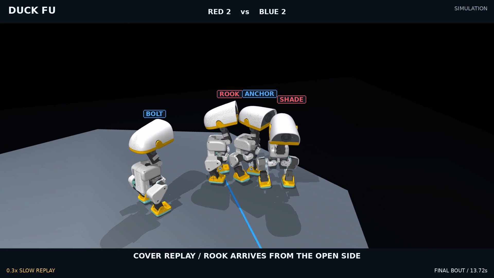

# Duck Fu: team cover and a physical finish

[中文](README.zh-CN.md) · [English film, 48.9 s](media/finish_en.mp4) · [Training source and checkpoints](../../../../training/combat/finish-native/README.md) · [Frozen selection](../../../../artifacts/combat/v2/finishing/selection.json)

[](media/finish_en.mp4)

Four native Microducks fight a free 2v2 bout on one octagonal platform. Public-state rules coordinate withdrawal, cover and flank approaches; learned joint policies execute movement, contact and braking. Physical ring-outs decide the result. This remains an optional simulation experiment awaiting viewing acceptance.

## What the film actually shows

The complete **25.04-second match** stays at 1×, interrupted by explicitly marked recorded-state replays. SHADE withdraws while ROOK takes a cover assignment and contacts ANCHOR from his open side at 13.72 s. ANCHOR exits at 21.76 s. BOLT recovers from his 20.44 s fall by 22.30 s; ROOK changes targets and makes another measured flank contact at 23.62 s. BOLT exits at 25.04 s. **RED wins with both ROOK and SHADE remaining.**

The 48.9-second edit adds three close slow replays, an opening preview and a labelled final frame hold. Cameras, names and the live-target minimap only read the recorded simulation. English TTS, contact-triggered taps, an original synthesized music bed and the final whistle are post-production, not sensor audio. The separate three-second continuation confirms both winners can remain supported and stop after the bell; it does not change the match result.

## Method

- **Team decisions:** both teams read the same current public body snapshot. Persistent assignments request pressure, withdrawal, cover or a flank. Opponent phases, future actions and evaluator seeds are unavailable to the pilots.
- **Finishing geometry:** an upright, supported robot can continue close contact for up to 2.2 s and approach from the inner side. A boundary guard extrapolates measured velocity 0.35 s ahead, requests the current skill's zero-command brake, then waits for measured support and low speed before moving inward.
- **Learned control:** the new native-opponent PPO motor is scoped to `finish_drive` and its braking. Short bumps, counter drives, walking, evasion and recovery keep their separate policies. Every motor uses 61 observations, 14 joint offsets and unfiltered 50 Hz output. Actual previous executed offsets cross policy handoffs.
- **Shared physics:** all four 0.73724318 kg robots keep native mass/inertia, 14 capped servos, native self/floor contacts and 70 massless external component hulls. Friendly robots collide. No added root force, health-based knockback, root teleport or weak-point damage multiplier decides the fight.

The actor sees proprioception and native physical commands; only the training critic has privileged relative geometry. This is motor PPO against frozen native opponent policies, composed with rule-based team tactics. It is not a claim of learned end-to-end 2v2 tactics, camera-based perception, live Jev decisions or hardware transfer.

## Training and challenges

Four long-run versions logged **3,207,168 environment transitions**, excluding smoke tests and qualification. The final fixed-normalizer version completed 251 iterations at 256 environments. Earlier runs stopped at their recorded checkpoints; they are not labelled completed runs. A measured input-normalization drift motivated preserving the imported actor statistics while continuing to train all actor weights and the critic. [Run counts](../../../../training/combat/finish-native/run-counts.json), source variants, logs, the exact seed, selected checkpoint 50, final checkpoint 250 and a rejected diagnostic checkpoint are retained.

The film assembly was frozen before held-out seeds `220001..220004` were run. Four base seeds × two side swaps produce eight paired starts per assembly; rotations, swaps and style trials are correlated.

| Held-out free bouts, same V4 rules and physics | Previous contact motor | Scoped native finishing motor |
| --- | ---: | ---: |
| Numerical checks passed | 8/8 | 8/8 |
| Wins / timeout draws | 4 / 4 | 5 / 3 |
| DOWN events | 25 | 21 |
| Uninterrupted upright evade/miss/counter sequences | 0 | 1 |

This small cohort does not establish a general win-rate improvement. Counts also depend on bout duration. The standalone bounded native-opponent course is **11/24 supported finishes for the previous motor and 6/24 for the selected new motor**. The new bare motor is therefore not a universal upgrade. Checkpoints 100/200/250, failed adaptive-normalizer candidates, additional styles and a larger ring remain in the [audit](../../../../artifacts/combat/v2/finishing/). Existing configurations remain available; the selected assembly is explicit and optional.

All **28 held-out executions** pass the unchanged numerical checks, including counter/counter, pressure/pressure and mixed-style bouts on a 1.0 m radius ring. All eight old/new paired starts have bit-identical initial integration states. Additional style groups produce 2/4, 1/4 and 1/4 wins respectively; the remaining bouts draw. Their shared base seeds make these challenge groups correlated, not an independent win-rate estimate.

The selected film's maximum penetration is **0.454 mm**, with a 0.6405 Nm torque cap, zero applied external forces, an unchanged model and no solver warnings. The gates remain 3 mm maximum and 1.5 mm penetrating-contact P99. Component hulls and compliant numerical contact are approximations; a recent measured contact is not counterfactual proof that a single blow caused an exit.

## Reproduce

Use the repository's pinned combat environment and upstream assets. From the delivery repository root:

```bash
export PYTHONPATH=src:scripts OPENBLAS_NUM_THREADS=1
python scripts/run_combat.py --config configs/combat/v2/team_finish_showcase.yaml \
  --seed 210001 --capture --out artifacts/combat/local/reproduced-finish
python scripts/check_combat_winner_hold.py \
  --run artifacts/combat/local/reproduced-finish --out /tmp/finish-hold.json
python scripts/build_combat_finisher_film.py \
  --run artifacts/combat/local/reproduced-finish \
  --storyboard docs/combat/v2/finishing/media/storyboard.json \
  --hold-audit /tmp/finish-hold.json --out out/duckfu-reproduced/plan.json
python scripts/render_combat_film.py --plan out/duckfu-reproduced/plan.json \
  --out out/duckfu-reproduced/silent.mp4
python scripts/sound_combat_film.py --plan out/duckfu-reproduced/plan.json \
  --silent-video out/duckfu-reproduced/silent.mp4 \
  --out out/duckfu-reproduced/finish_en.mp4 --tts /path/to/edge-tts
python scripts/check_combat_film.py --video out/duckfu-reproduced/finish_en.mp4 \
  --plan out/duckfu-reproduced/plan.json --out /tmp/finish-film-check.json
```

All 2,445 final frames map to actual captured integration states; slow motion uses those states without generated in-between animation. Full binary scene, integration tape and solved substep contacts remain local because of their size. Compact source manifests, events, motor/body tape, winner continuation, frame mappings and [film verification](../../../../artifacts/combat/v2/finishing/film-check.json) are included. Delivery tests: **243 passed**; clean training rebuild: **14 passed**. No new Release, tag or merge is issued.
