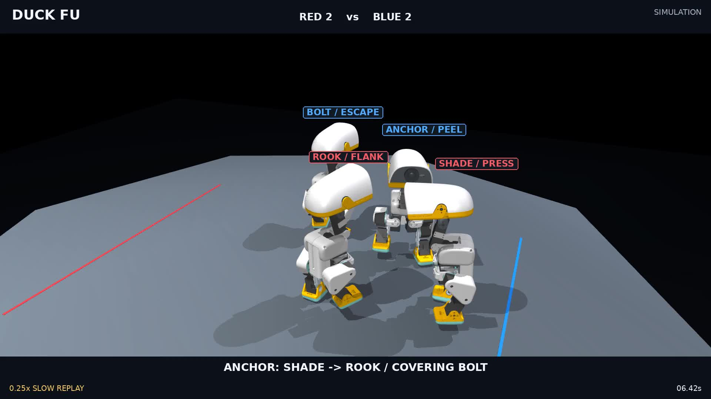

# Duck Fu V2 round two: committed team cover

[中文](README.zh-CN.md) · [First-round methods](../README.md) · [Machine-readable results](../../../../artifacts/combat/v2/round2/final-evaluation.json)

This round makes team assignments persist through execution. It improves the connection between a public-state cover plan, the duck's actual target, and the role shown on screen. The three learned body policies, physical bodies, torque caps and referee remain frozen. High-level control is transparent rules; no new PPO, Jev or online language model runs in these matches.

[](media/team_review.mp4)

- [English match, slow replays and solved-contact details](media/team_review.mp4): **86.58 s, 1080p, 50 fps, silent**. The first 60 seconds contain the complete uninterrupted match; replays and frame holds are explicitly labelled. The match ends in a time-limit draw.
- [Uninterrupted reference](media/team_reference.mp4): 60 s, 720p, 50 fps, silent.

The selected match demonstrates retained target changes by both teams. It is an editorial example from the frozen evaluation, not another independent trial. Native materials are preserved. ROOK and SHADE are RED; BOLT and ANCHOR are BLUE. PEEL intervenes against a teammate's pursuer; ESCAPE attempts to disengage.

## Controller changes

Old configurations retain `controller_revision: 1`. New configurations explicitly select revision 2.

- An active committed attack or evade keeps its executed target **and role** until a safe maneuver boundary. Adoption of a new plan emits `TEAM_ASSIGNMENT_ADOPTED`. Previously the display could say PEEL while the body was still committed to another target.
- Public boundary margin, outward velocity, uprightness and distances trigger cover earlier. Cover persists for up to five seconds; early clearance requires 0.8 seconds of sustained safe geometry. Eliminated teammates invalidate stale assignments.
- The protected duck considers inward and lateral walking goals around visible obstacles. Constant-velocity previews are steering costs; no collision response or root state is edited.
- A counter checks its own actual motor state again after turning, before entering the probe.

Forward and lateral turn alternatives and an earlier clearance-based handoff did not reliably improve counters and were rejected. An exploratory friendly-lane candidate also remains unmerged without independent qualification. Development reports and source patches are retained in the [evidence directory](../../../../artifacts/combat/v2/round2).

## Frozen evaluation

Actor source was frozen at **`693f662`** before seeds **110001–110004** were run. Both revisions use paired sides and rotated headings. All 40 paired initial physical states match. Five conditions, sides and revisions share four base seeds: these are **80 correlated games**, not 80 independent draws. Revision 1 here is the first-round **V2 controller**, not the original V1 actor.

| Condition | Games per revision | Numerical pass, old / new | Qualified target-change interventions, old / new | DOWN events across both teams, old / new |
| --- | ---: | ---: | ---: | ---: |
| Pressure opponent, 15 s duel | 8 | 8 / 8 | — | 0 / 0 |
| Counter opponent, 15 s duel | 8 | 8 / 8 | — | 2 / 2 |
| 20 s free team, RED V2 vs BLUE V1 rules | 8 | 8 / 8 | 1 / 0 | 8 / 6 |
| 20 s pressure-layout course | 8 | 8 / 8 | 1 / 0 | 4 / 2 |
| Up to 60 s free team, both teams V2 | 8 | 8 / 8 | **2 / 12** | **16 / 21** |

Long-match interventions occur in **1/8 versus 7/8 games**. Observed decreases in the protected duck's nearby enemy density accompany **0 versus 8 events**. These observations establish retained intent, directed travel and contact, not causal rescue or improved win rate. All long matches are time-limit draws. More falls in the new long matches and no short-match intervention improvement prevent a claim of general superiority.

The original strict intervention definition is unchanged: switch away from a previous actual target; a new contact episode starts within three seconds, at least 0.12 s after switching; move at least 3 cm toward the initial new target; episode impulse is at least 0.01 N·s; retain PEEL, the actual target and the relevant team plan at contact. Same-target role changes do not count toward this metric.

Clean counters against pressure are **4 / 4**, and against counter-style opponents **0 / 0**. Fifteen of sixteen paired duel control/body/phase tapes are identical. No new counter-speed advantage is demonstrated. The proposed 30% paired latency improvement and 50% nonprogress-contact reduction remain unmet.

## What the close-ups show

| Actor | Switch / protected teammate | Switch time | Contact time | Directed own travel | Episode impulse |
| --- | --- | ---: | ---: | ---: | ---: |
| ANCHOR | SHADE → ROOK / BOLT | 4.22 s | 6.606375 s | 9.77 cm | 0.08586 N·s |
| SHADE | BOLT → ANCHOR / ROOK | 30.98 s | 32.341875 s | 6.79 cm | 0.17667 N·s |

Slow motion samples actual recorded integration states. Collision overlays show the physical geometry, with a point and normal taken from the solved contact log. Displayed forces of 169.97 N and 407.07 N are **peak individual solver contacts**, not sustained loads or hardware measurements. The two-second display is explicitly a single-frame hold. An optional `attack_id` identifies an associated legacy response event and can belong to the other contact participant; a cover actor need not own that attack window.

## Physical checks and limits

**80/80** games pass the unchanged numerical checks; maximum penetration is **1.790 mm**. Limits remain 3 mm maximum and 1.5 mm penetrating-subset P99. MuJoCo 3.12.0/libccd runs at 8 kHz with 50 Hz motors, native inertia, ±0.6405 N·m caps, friendly collision and self-contact. There are no runtime root edits or external knockback forces.

Both selected 60-second captures reproduce all **480,000** integration states with **zero error**, identical motor histories, contacts, semantic logs and referee. Captured control/body/phase tapes also match their noncapture evaluation runs exactly.

Fixed-input 0.4-second dt/dt÷2 windows near the two support contacts pass at both steps. Maximum final root differences are **0.225 mm / 2.862 mm** and all-duck impulse relative differences **0.685% / 5.223%**. This is a local component check, not long-horizon winner convergence or hardware validation.

A separate development edge-fall was numerically rejected at 3.257 mm stage penetration. Halving its local timestep produced 4.233 mm and still failed; no timestep switch was used to hide it. That run is retained as a failure and excluded from qualified media. [Edge diagnostic](../../../../artifacts/combat/v2/round2/stage-edge-dt-check.json).

## Reproduction

Prepare the environment and frozen assets using the [existing setup](../README.md#run). Set `MICRODUCK_ROOT`, `PYTHONPATH=src` and `OPENBLAS_NUM_THREADS=1`.

```bash
python scripts/run_combat.py \
  --config configs/combat/v2/selected_team_round2.yaml \
  --seed 110001 --capture --out artifacts/combat/local/round2-reproduction

python scripts/eval_combat_revision_v2.py \
  --out artifacts/combat/local/round2-new-evaluation \
  --group pressure --group counter --group free --group course --group open \
  --revision 1 --revision 2 --seed-base 110001 --seeds 4 --jobs 6 --split validation
```

Large full-state/contact captures remain local. The repository contains configs, compressed raw summaries, hashes, frame mappings and verification reports. Paths and environment versions can change manifest hashes; exact closed-loop replay requires matching actor source, MuJoCo and assets. **215 tests pass.**

Next priorities are transition training from actual predecessor states, fewer long-match falls, and safe regrouping after cover. This remains development work pending human acceptance, official ROSClaw authorization receipts and hardware validation. No Release or tag was created.
