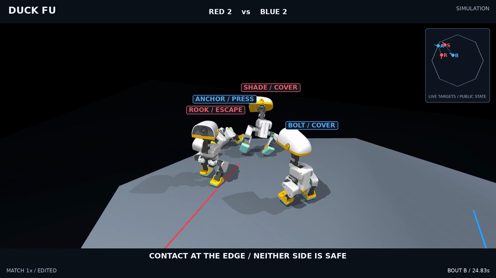

# Duck Fu：战术 2v2

[English](README.md) · **简体中文** · [项目主页](../../../../README.zh-CN.md)

[全英文成片：63.88 秒，1080p，50 fps](media/tactical_en.mp4)。以两场自由对抗展示牵制、切侧、闪避反击和边缘掩护，保留实际平局。每个镜头标明 BOUT A/B、源比赛时间及慢放倍率；切换比赛时明确显示 NEW BOUT。解说、接触触发音效和节奏底音均为后期制作，不是仿真麦克风录音。机器人保留资产原生材质。

## 方法

新增可选 `controller_revision: 3`：用公开位置、速度、朝向、头部姿态和接触状态，协调已有冻结的学习运动策略。**本轮没有重新训练运动网络，没有新战术神经网络，也没有 Jev 调用。**

反击风格让前方队员牵制，侧翼绕路；施压风格保持两条进攻路线。发现失衡、边缘或孤立的对手时尝试侧压，但仍需应对另一只敌鸭。队友被逼近边缘时，分配撤离与掩护。目标和角色只在动作边界更新；屏幕角色是已采用的任务，不等于该战术已成功。

连续、有界的步行输入改善转向；观察到对方接近或低头起手时，可以侧移。自己的实际脚底支撑、身体姿态、关节速度和动作历史决定能否接转身与反顶。重突进比短顶保持更长的接触承诺。敌我及队友之间都保留物理碰撞。

“脆弱位置”在本轮落实为公开几何上的侧面、失衡姿态与边缘处境，没有虚构额外伤害或弱点倍率。侧面命中必须同时满足：攻击起动时，攻击者位于目标朝向 60° 以外；随后发生求解器冲量和可观察响应。一记顶撞不自动算淘汰，胜负仍依靠真实出界和既有倒地读秒；没有修改根节点位姿、速度或施加额外推力。

## 实测与限制

冻结控制代码为 `7cafc1a`。验证使用四个新基础种子 `200001–200004`，每个交换左右场，共八组相同初态配对；不是 16 个独立随机种子。两版使用同一组运动模型、可选学习恢复模式及物理参数。这是整套控制改动的比较，不能将结果单独归因于某个功能。

| 每版各八场 | Revision 2 | Revision 3 |
| --- | ---: | ---: |
| 求解器合格响应事件 | 92 | 192 |
| 起动时位于侧面的合格响应 | 43 | 65 |
| 持续直立且不中断的闪避—扑空—反击序列 | 1 | 3 |
| 响应时附近有站稳队友的事件 | 67 | 123 |
| DOWN 事件 | 20 | 19 |
| 跌出擂台 | 8 | 4 |
| 获胜 / 超时平局 | 1 / 7 | 0 / 8 |

16 场均通过原物理数值检查，最大穿入深度 **1.7254 mm**，没有放宽 3 mm 上限。两段选中素材各 60 秒、480,000 个物理步，闭环重放全部状态误差为零，接触和裁判结果一致。补录验证素材的控制、身体及相位数组与原非补录运行逐项相同。

旧反击检测器记到新控制四段序列，其中一段中途摔倒。因此额外进行**事后收紧审核**：全程直立度至少 0.94，并排除恢复、倒地和淘汰，剩三段。成片选中的快速反击全程直立度超过 0.996。这个审核不修改控制器、奖励或胜负。“附近有站稳队友”也只是几何指标，不是队友因果救援成功率。**新控制八场仍全部平局，不能宣称制胜能力已提升，也未完成既有反击提速目标。**

两处 0.4 秒固定输入的半步长检查均保持有限、无警告并通过数值门槛。反击窗口末端根位置相差 **0.86 mm**，鸭间冲量相差 **1.10%**；边缘窗口为 **4.01 mm / 19.25%**。边缘混战仍对步长敏感，不能将一次片段的胜负推广为步长无关或真机结论。完整测试 **231 项通过**。

## 素材选择与复现

A 场为验证种子 `200003`、不交换左右场，选中原因是存在两段持续直立的真实反击，特写选择其中更快的一段。B 场为开发种子 `190002`，选中原因是掩护切入、侧面响应，以及 ANCHOR 在 25.40 秒、SHADE 在 25.60 秒的真实双出界。两场最终均为超时平局。视频是精彩片段选择，不代表典型比赛表现，也没有把两局拼成一局胜利。

完整命令见 [English reproduction](README.md#film-selection-and-reproduction)。中英文项目主页已加入新视频；逐步状态、完整接触记录和原始中间片在本地保留，仓库提供压缩审核、复现配置和帧来源，不提交数 GB 的全量状态文件。移动路径后需重建镜头计划。

[结果、重放及物理检查](../../../../artifacts/combat/v2/tactics/) · [控制源码](../../../../src/microduck_lab/combat/tactics_v3.py) · [英文字幕](media/tactical_en.en.srt)。当前仍等待观感验收，不发布 Release、tag，也不合并 PR。
