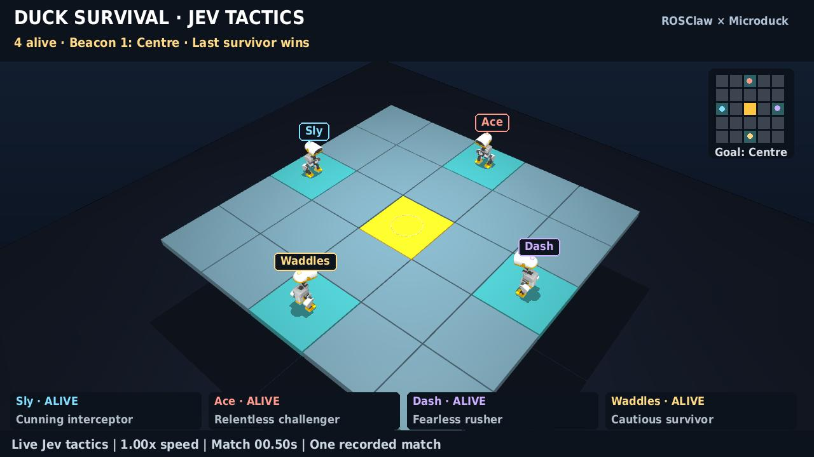

# English sports-commentary edition

[Watch / download the English film](https://github.com/ros-claw/microduck/releases/download/jev-survival-2026-10-10/jev-rumble-commentary-en.mp4) · [English subtitles](https://github.com/ros-claw/microduck/releases/download/jev-survival-2026-10-10/jev-rumble-commentary-en.srt) · [Methods](README.md) · [Validation](VALIDATION.md)



The 110.88-second, 1280×720, 50 fps edition uses the **same accepted match and chronological slow-motion timeline** as the Mandarin film. It is a presentation localization, not another online Jev match. Robot states, controls, contacts, elimination times and winner are unchanged. English speech lengths determine how long speaker close-ups remain on screen.

| Recorded body | Mandarin identity | English identity | Personality | Badge colour |
| --- | --- | --- | --- | --- |
| lavender | 张三 | **Dash** | A fearless rusher who goes straight for the beacon | Lavender |
| cream | 二呆 | **Waddles** | A cautious survivor who prefers room to manoeuvre | Gold |
| sky | 老六 | **Sly** | A cunning interceptor looking for a route to cut off | Sky blue |
| graphite | 卷王 | **Ace** | A relentless challenger chasing contested positions | Coral |

These are English presentation identities for the existing characters. The original Jev inputs and recorded choices are preserved; renaming does not claim that the tactical model was rerun with different personality prompts.

All visible titles, body labels, status cards, tactical intentions, floor countdowns, winner labels and subtitles are English. Twenty-one synthetic English sports-commentary cues retain the original event/decision provenance and include a short character introduction. The voice is `en-GB-RyanNeural`; event Foley and a quiet original rhythmic bed use the same mix as the Mandarin edition, with speech ducking and two-pass loudness mastering at −16 LUFS / −1.5 dBTP. Audio is synthesized presentation, not microphone-recorded robot sound.

## Recreate this edition

Install the repository dependencies and assets, download/extract the accepted match's replay files as explained on the [Release](https://github.com/ros-claw/microduck/releases/tag/jev-survival-2026-10-10), and check out the [English presentation source](https://github.com/ros-claw/microduck/tree/a0f0b41). The actor source remains frozen to the accepted match. Install `requirements-commentary.txt` into `.tts-venv`; it pins the upstream [service compatibility fix](https://github.com/rany2/edge-tts/pull/492) because the previous released package no longer synthesized speech during this production.

```bash
PYTHONPATH=src .venv/bin/python scripts/render_jev_rumble.py \
  --run artifacts/jev-rumble/release --out out/jev-english-plan.json --plan-only --language en
PYTHONPATH=src .venv/bin/python scripts/commentate_jev_english.py \
  --run artifacts/jev-rumble/release \
  --source artifacts/jev-rumble/media/final-speech.json \
  --plan out/jev-english-plan.json --out out/jev-english-speech.json
PYTHONPATH=src OPENBLAS_NUM_THREADS=1 .venv/bin/python scripts/render_jev_rumble.py \
  --run artifacts/jev-rumble/release --out out/jev-rumble-silent-en.mp4 \
  --speech out/jev-english-speech.json --language en
PYTHONPATH=src .venv/bin/python scripts/sonify_survival_rumble.py \
  --run artifacts/jev-rumble/release --video out/jev-rumble-silent-en.mp4 \
  --speech out/jev-english-speech.json --out out/jev-rumble-commentary-en.mp4
PYTHONPATH=src .venv/bin/python scripts/check_jev_media.py \
  --run artifacts/jev-rumble/release --video out/jev-rumble-commentary-en.mp4 \
  --out out/jev-english-checks.json
```

Generating the English film needs network access for synthetic speech but **no fresh Jev API calls**. The media checker decodes the whole movie, checks audio levels and every cue's evidence, validates monotonic recorded frame indices, verifies the sole survivor's support rule and rejects Chinese characters in rendered English text/subtitles. The selected match's physical limitations, including incomplete dynamic get-up, remain exactly those in [VALIDATION.md](VALIDATION.md).
